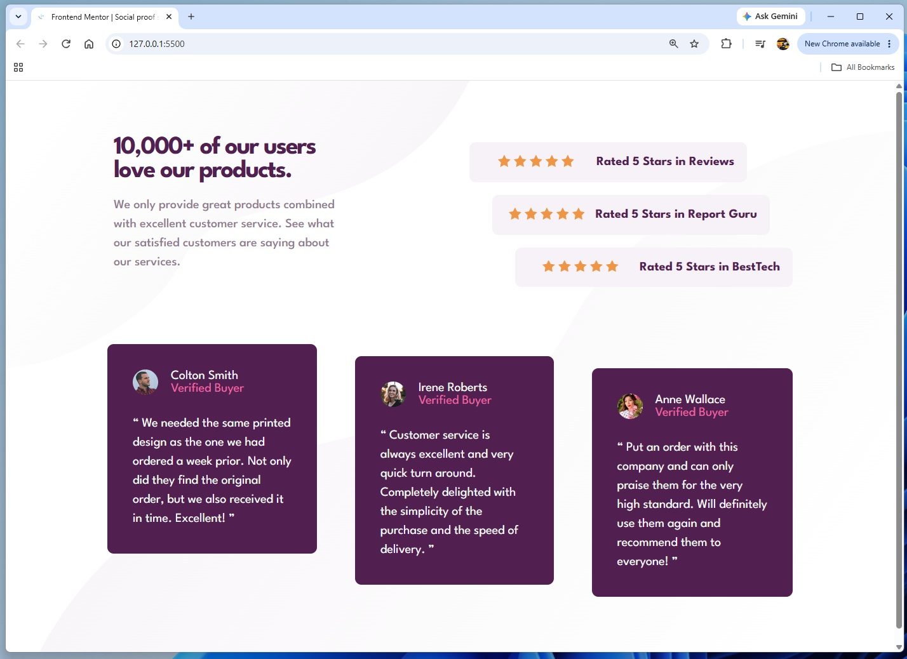

# Frontend Mentor - social proof section solution

This is a solution to the [social proof section challenge on Frontend Mentor](https://www.frontendmentor.io/social-proof-section-6e0qTv_bA). Frontend Mentor challenges help you improve your coding skills by building realistic projects. 

## Table of contents

- [Overview](#overview)
  - [The challenge](#the-challenge)
  - [Screenshot](#screenshot)
  - [Links](#links)
- [My process](#my-process)
  - [Built with](#built-with)
  - [What I learned](#what-i-learned)
  - [AI Collaboration](#ai-collaboration)

## Overview

### The challenge

Users should be able to:

- View the optimal layout depending on their device's screen size

### Screenshot

### Links

- Solution URL: [GitHub repo](https://github.com/Acemeistre/FEM_Social-proof-section/)
- Live Site URL: [Live site](https://acemeistre.github.io/FEM_Social-proof-section/)

## My process

### Built with

- Semantic HTML5 markup
- CSS custom properties
- Flexbox
- CSS Grid

### What I learned

#### Achievements 

- Using the spacing typography has now replaced the need to enter multiple rem values.
- Using `nth-child` to stagger rating card positions.
- Using `grid-row: span 2;` for the author row prevented the need for multiple divs, simplyfying the html code.

#### Challenges

- Using `::before` and `::after` to place curly brackets around review quotes.
- Multiple different child elements for reviews meant I needed to use `nth-of-type`, rather than `nth-of-child`.
- Some cards didn't flex in sync with each other, on desktop, for the staggered cards but applying a large enough `width` solved the issue.

#### Continued development/help

- Flex-box still poses its challenges in both row and column flex's 
    - when to use text-justify/align, justify/align-content, etc.
- Practise linking background image URLs correctly, since the path is relative to the CSS file, not the HTML.

## AI Collaboration

- Tools used - Claude.
- Used for - debugging and brainstorming solutions.